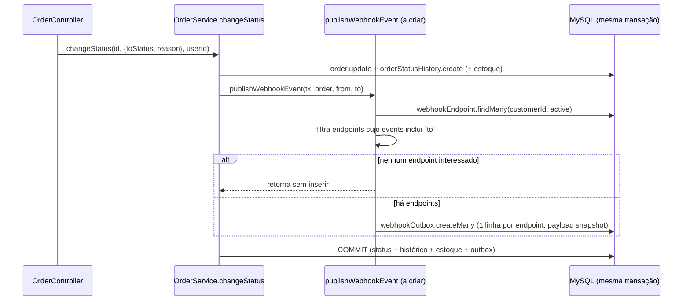
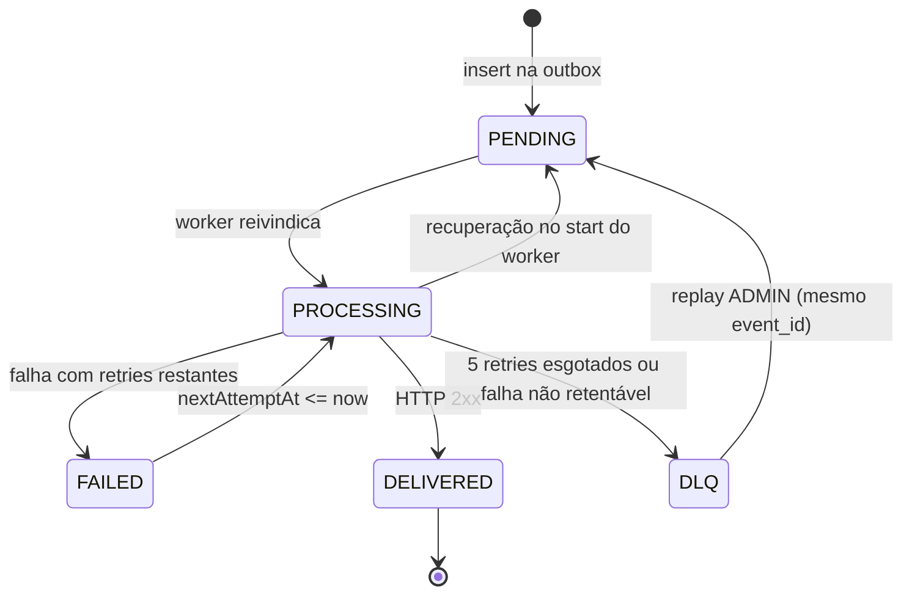

# FDD: Sistema de Webhooks de Notificação de Pedidos

| Campo | Valor |
| --- | --- |
| **Autor** | Larissa (Tech Lead) |
| **Status** | Em revisão (acompanha o [RFC](RFC.md)) |
| **Data** | 2026-11-24 |
| **Revisores** | Marcos, Bruno, Diego, Sofia |
| **Documentos relacionados** | [PRD](PRD.md) · [RFC](RFC.md) · [ADRs](adrs/README.md) · [Tracker](TRACKER.md) |

**Como ler a coluna "Origem".** Este documento especifica *como construir*. Cada item é de um de dois tipos, e a diferença importa para a revisão:

- **`[hh:mm] Nome`**: decisão ou requisito dito na reunião (transcrição) ou fato do código (caminho de arquivo).
- **Proposta**: detalhe de implementação que a reunião não definiu e que foi preenchido aqui para o documento ser acionável. É sugestão a validar no review, não decisão. As propostas relevantes estão consolidadas na [seção 14](#14-propostas-pendentes-de-validação).

Caminhos marcados como *(a criar)* são arquivos novos da feature; os demais já existem no repositório.

---

## 1. Contexto e motivação técnica

O OMS (Node.js + TypeScript, Express 4, Prisma 5.22 sobre MySQL 8) não possui notificação externa, eventos, filas ou webhooks. Três clientes B2B precisam saber, em menos de 10 segundos, quando o status de seus pedidos muda (`[09:00] Marcos`, `[09:02] Marcos`). Por que isso exige desenho próprio, e não só um HTTP call:

1. **A origem do evento é uma transação pesada.** `OrderService.changeStatus` (`src/modules/orders/order.service.ts`) atualiza `orders`, insere em `order_status_history` e movimenta `products.stockQuantity` em um único `prisma.$transaction` (`[09:04] Bruno`).
2. **Falha de cliente não pode afetar o pedido.** Cliente lento ou fora do ar não pode travar nem reverter status (`[09:04] Bruno`).
3. **Evento e status precisam ser atômicos.** Não pode existir status mudado sem evento, nem evento de status revertido (`[09:40] Bruno`, `[09:41] Diego`).

A arquitetura (Outbox + worker em polling + retry/DLQ + HMAC) está justificada nos ADRs [001](adrs/ADR-001-outbox-no-mysql.md) a [007](adrs/ADR-007-publicacao-transacional-com-snapshot-e-filtro.md) e resumida no RFC; este FDD não repete a argumentação, e sim a transforma em modelo de dados, fluxos, contratos e passos de integração.

## 2. Objetivos técnicos

| ID | Objetivo | Origem |
| --- | --- | --- |
| OT-01 | Registrar cada mudança de status relevante na outbox, na mesma transação de `changeStatus` | `[09:40] Bruno` |
| OT-02 | Entregar o evento por HTTPS em menos de 10 s após o commit, em condições normais | `[09:02] Marcos`, `[09:10] Larissa` |
| OT-03 | Rodar a entrega em processo separado da API (`src/worker.ts` *(a criar)*, `npm run worker`) | `[09:11] Diego`, `[09:11] Larissa` |
| OT-04 | Reenviar com backoff 1 min / 5 min / 30 min / 2 h / 12 h e mover para a DLQ ao esgotar | `[09:17] Larissa`, `[09:18] Diego` |
| OT-05 | Assinar cada envio com HMAC-SHA256, secret única por endpoint, rotação com 24 h de convivência | `[09:22] Sofia` |
| OT-06 | Garantir at-least-once e permitir deduplicação via `X-Event-Id` | `[09:26] Larissa` |
| OT-07 | Expor CRUD de configuração, rotação de secret, histórico de entregas e replay de DLQ | `[09:31] Marcos`, `[09:33] Bruno`, `[09:34] Marcos`, `[09:35] Diego` |
| OT-08 | Reusar os padrões do projeto (módulo, `AppError`, Pino, error middleware, `requireRole`, Zod, UUID) | `[09:30] Larissa` |
| OT-09 | Não introduzir dependências npm novas nem infraestrutura nova | `[09:07] Diego`, `[09:29] Bruno` (Proposta: confirmar no review) |

## 3. Escopo e exclusões

**Dentro do escopo**

- Webhooks **de saída** (nós enviamos, o cliente recebe) (`[09:02] Marcos`).
- Evento único `order.status_changed`, disparado por `changeStatus` (`[09:43] Diego`).
- Filtro por lista de status por endpoint, aplicado na inserção da outbox (`[09:34] Bruno`).
- Tabelas: configuração, outbox, histórico de entregas e DLQ.
- Worker, retry, DLQ, replay manual (ADMIN), rotação de secret e histórico de entregas.

**Fora do escopo (excluído ou adiado na reunião)**

| Item | Situação | Origem |
| --- | --- | --- |
| E-mail ao cliente quando o webhook falha | Adiado para próxima fase | `[09:37] Larissa` |
| Rate limiting de envio por cliente | "Observar e decidir depois" | `[09:39] Larissa` |
| Dashboard visual para o cliente | Fora; projeto do time de frontend | `[09:40] Larissa` |
| Arquivamento de linhas entregues (~30 dias) | Fora desta feature | `[09:08] Diego` |
| Múltiplos workers em paralelo / ordering global | Adiado; limitação conhecida | `[09:13] Larissa` |
| Webhooks de entrada (cliente → nós) | Não solicitado | `[09:02] Marcos` |
| Itens do pedido no payload | Excluídos para manter o payload enxuto | `[09:43] Diego` |
| Endurecer permissões do CRUD de configuração | "Por enquanto" qualquer role autenticada | `[09:37] Sofia` |

**Não discutido na reunião e, por isso, fora desta especificação** (Proposta): listagem de itens da DLQ via API (o admin obtém o `id` pelo log de falha e por consulta direta ao banco), evento de criação de pedido (ver Q8 na [seção 14](#14-propostas-pendentes-de-validação)) e alertas automáticos.

## 4. Modelo de dados

Tabelas novas, via migration Prisma (`prisma/migrations/<timestamp>_webhooks/`, a criar). Seguem as convenções de `prisma/schema.prisma`: PK `String @id @default(uuid()) @db.Char(36)` (`[09:51] Larissa`), `@@map` em snake_case, `createdAt`/`updatedAt`. Nenhuma tabela existente muda de colunas; `Customer` ganha apenas o campo de relação inverso exigido pelo Prisma.

```prisma
enum WebhookEventStatus {
  PENDING      // "pendente"
  PROCESSING   // "processando"
  FAILED       // "falhou": última tentativa falhou, retry agendado
  DELIVERED    // "entregue"
}

model WebhookEndpoint {
  id                      String    @id @default(uuid()) @db.Char(36)
  customerId              String    @db.Char(36)
  url                     String    @db.VarChar(2048)
  secret                  String    @db.VarChar(255)
  previousSecret          String?   @db.VarChar(255)
  previousSecretExpiresAt DateTime?
  events                  Json      // OrderStatus[] que o endpoint quer ouvir
  active                  Boolean   @default(true)
  createdAt               DateTime  @default(now())
  updatedAt               DateTime  @updatedAt

  customer    Customer            @relation(fields: [customerId], references: [id], onDelete: Cascade)
  outbox      WebhookOutbox[]
  deliveries  WebhookDelivery[]
  deadLetters WebhookDeadLetter[]

  @@index([customerId])
  @@map("webhook_endpoints")
}

model WebhookOutbox {
  id            String             @id @db.Char(36)   // = event_id / X-Event-Id (uuid v4 gerado na inserção)
  webhookId     String             @db.Char(36)
  orderId       String             @db.Char(36)       // sem FK (ver nota)
  eventType     String             @db.VarChar(64)    // "order.status_changed"
  payload       Json                                   // snapshot renderizado na inserção
  status        WebhookEventStatus @default(PENDING)
  attempts      Int                @default(0)        // envios já realizados
  nextAttemptAt DateTime           @default(now())
  lastErrorCode String?            @db.VarChar(64)
  lastError     String?            @db.VarChar(500)
  createdAt     DateTime           @default(now())
  updatedAt     DateTime           @updatedAt

  webhook WebhookEndpoint @relation(fields: [webhookId], references: [id], onDelete: Cascade)

  @@index([status])                    // [09:08] Diego
  @@index([createdAt])                 // [09:08] Diego
  @@index([status, nextAttemptAt])     // Proposta: leitura do worker com backoff
  @@index([orderId])
  @@map("webhook_outbox")
}

model WebhookDelivery {
  id           String   @id @default(uuid()) @db.Char(36)
  eventId      String   @db.Char(36)
  webhookId    String   @db.Char(36)
  attempt      Int
  success      Boolean
  statusCode   Int?
  durationMs   Int
  errorCode    String?  @db.VarChar(64)
  responseBody String?  @db.Text   // truncado (ver 8.5)
  payload      Json
  createdAt    DateTime @default(now())

  webhook WebhookEndpoint @relation(fields: [webhookId], references: [id], onDelete: Cascade)

  @@index([webhookId, createdAt])
  @@index([eventId])
  @@map("webhook_deliveries")
}

model WebhookDeadLetter {
  id            String    @id @default(uuid()) @db.Char(36)  // :id do endpoint de replay
  eventId       String    @db.Char(36)
  webhookId     String    @db.Char(36)
  orderId       String    @db.Char(36)
  eventType     String    @db.VarChar(64)
  payload       Json                                          // [09:18] Diego
  failureCode   String    @db.VarChar(64)                     // motivo da falha
  failureReason String    @db.VarChar(500)                    // [09:18] Diego
  attempts      Int
  failedAt      DateTime  @default(now())                     // timestamp [09:18] Diego
  replayedAt    DateTime?                                     // Proposta: auditoria
  replayedById  String?   @db.Char(36)                        // Proposta: auditoria

  webhook WebhookEndpoint @relation(fields: [webhookId], references: [id], onDelete: Cascade)

  @@index([webhookId])
  @@index([failedAt])
  @@map("webhook_dead_letter")
}
```

No `model Customer` existente, acrescentar apenas `webhookEndpoints WebhookEndpoint[]`.

| ID | Decisão de modelagem | Origem |
| --- | --- | --- |
| FDD-DADOS-01 | Quatro status do evento: pendente, processando, falhou, entregue | `[09:08] Diego` |
| FDD-DADOS-02 | Índices em `status` e `created_at` na outbox | `[09:08] Diego` |
| FDD-DADOS-03 | DLQ em tabela separada, com payload, motivo e timestamp | `[09:18] Diego` |
| FDD-DADOS-04 | Todas as PKs UUID | `[09:51] Larissa` |
| FDD-DADOS-05 | Config guarda URL, secret, customer e estado ativo | `[09:21] Bruno` |
| FDD-DADOS-06 | **Uma linha de outbox por endpoint de destino**, com `id` = `event_id`. Retry, status e `X-Webhook-Id` são por endpoint; um customer com 2 endpoints gera 2 linhas | Proposta (decorre de `[09:44] Sofia`: `X-Webhook-Id` identifica o cadastro) |
| FDD-DADOS-07 | **Sem FK de `orderId` para `orders`**: `OrderService.delete` (`src/modules/orders/order.service.ts`) permite apagar pedidos `PENDING` ou `CANCELLED` (só os `CANCELLED` tendem a ter eventos, enquanto a criação não gerar evento, ver Q8); uma FK sem cascade bloquearia essa operação existente. O snapshot torna a FK desnecessária | Proposta (código: `delete`, `prisma/schema.prisma`) |
| FDD-DADOS-08 | `onDelete: Cascade` de `webhook_endpoints` para as tabelas filhas, como já ocorre em `OrderItem` e `OrderStatusHistory` | Proposta (código: `prisma/schema.prisma`) |
| FDD-DADOS-09 | `events` como `Json` (lista de `OrderStatus`), no mesmo estilo de `Customer.address`; filtragem em código | Proposta (código: `prisma/schema.prisma`) |
| FDD-DADOS-10 | `secret` e `previousSecret` na própria linha do endpoint, com `previousSecretExpiresAt`; uma única secret anterior por vez | Proposta (viabiliza `[09:21] Sofia`) |

## 5. Fluxos detalhados

### 5.1 Criação do evento na outbox (FDD-FLUXO-01)

Ocorre **dentro** do `prisma.$transaction` de `OrderService.changeStatus`, depois de `tx.order.update` e `tx.orderStatusHistory.create` e antes da releitura `refreshed` (`[09:40] Bruno`).



Passos de `publishWebhookEvent(tx, order, fromStatus, toStatus)`: função que recebe o client transacional, sem injetar repository no `OrderService` (`[09:41] Bruno`, `[09:41] Diego`).

1. Buscar `tx.webhookEndpoint.findMany({ where: { customerId: order.customerId, active: true } })`.
2. Manter só os endpoints cujo `events` contém `toStatus`. Se nenhum, retornar sem inserir (`[09:34] Bruno`).
3. Para cada endpoint restante, gerar `eventId = uuidv4()` (pacote `uuid` já em `package.json`) e renderizar o **snapshot** do payload (seção 6.8) com os dados do pedido naquele momento (`[09:52] Larissa`).
4. Inserir todas as linhas com um único `tx.webhookOutbox.createMany` (`status: PENDING`, `attempts: 0`, `nextAttemptAt: now`).
5. Qualquer erro na função é encapsulado em `WebhookEventPublishError` (500) e propagado: a transação sofre rollback e o status **não** muda (`[09:40] Bruno`).

Observações de implementação (Proposta):

- `changeStatus` descarta hoje o retorno de `tx.order.update`. Capturá-lo (`const updated = await tx.order.update(...)`) evita passar um `order` com status antigo; `order` lido no início da transação ainda traz `status = from`.
- Duas queries (uma leitura, uma escrita em lote) mantêm a transação curta; ver risco FDD-RISCO-01.
- O filtro de status também vale para PATCH de `events` (afeta apenas eventos futuros; linhas já na outbox não são removidas).

### 5.2 Processamento pelo worker (FDD-FLUXO-02)

Processo próprio: `src/worker.ts` *(a criar)*, espelhando `src/server.ts` (bootstrap, logger, `SIGINT`/`SIGTERM`), com `PrismaClient` próprio sobre a mesma `DATABASE_URL` (`[09:30] Bruno`). A lógica fica em `src/modules/webhooks/webhook.processor.ts` *(a criar)* (`[09:28] Bruno`).



Laço (Proposta para os detalhes; 2 s e ordem por `created_at` vêm da reunião):

1. **Start:** `UPDATE webhook_outbox SET status='PENDING' WHERE status='PROCESSING'`. Eventos que ficaram em voo por queda do processo são reenviados (at-least-once, ver [ADR-005](adrs/ADR-005-at-least-once-com-x-event-id.md)).
2. **Poll:** buscar eventos com `status IN (PENDING, FAILED)` e `nextAttemptAt <= now`, `ORDER BY createdAt ASC`, `LIMIT OUTBOX_BATCH_SIZE` (`[09:08] Diego`: batch pequeno; `[09:09] Diego`: "mais antigos").
3. **Para cada evento, em sequência:**
   1. *Reivindicar:* `updateMany({ where: { id, status: { in: [PENDING, FAILED] } }, data: { status: PROCESSING } })`; se `count !== 1`, pular.
   2. *Pré-checagens:* endpoint existe e está ativo (senão `WEBHOOK_ENDPOINT_INACTIVE`, não retentável), secret presente (`WEBHOOK_SECRET_REQUIRED`), corpo ≤ 64 KB (`WEBHOOK_PAYLOAD_TOO_LARGE`, não retentável).
   3. *Montar a requisição:* serializar o payload **uma vez** (`JSON.stringify`), assinar essa mesma string e enviá-la como corpo (seção 6.8).
   4. *Enviar:* `fetch` nativo do Node 20+ com `AbortController` de 10 s, `redirect: 'manual'` (`[09:42] Diego`).
   5. *Registrar:* inserir `webhook_deliveries` (sucesso ou falha) e aplicar o resultado (5.3).
4. **Esperar:** agendar a próxima rodada com `setTimeout(2000)` **após** terminar a anterior (não `setInterval`), para evitar rodadas sobrepostas (`[09:09] Diego`).
5. **Erros do laço** (ex.: banco indisponível) são logados e a rodada seguinte é tentada normalmente; o processo não encerra.
6. **Shutdown:** em `SIGINT`/`SIGTERM`, parar de agendar rodadas, terminar o envio em curso, `prisma.$disconnect()` e sair, como em `src/server.ts`.

### 5.3 Retry (FDD-FLUXO-03)

Tabela fixa no código (`[09:17] Larissa`, consolidada em `[09:48] Larissa`):

| Falha nº | Próximo envio em | Atraso acumulado desde a 1ª falha |
| --- | --- | --- |
| 1ª | +1 min | 1 min |
| 2ª | +5 min | 6 min |
| 3ª | +30 min | 36 min |
| 4ª | +2 h | 2 h 36 min |
| 5ª | +12 h | 14 h 36 min |
| 6ª | **DLQ** | (sem novo envio) |

**Leitura adotada (Proposta, ver Q9):** "5 tentativas" = **1 envio inicial + 5 retries**, totalizando até 6 chamadas HTTP. É a leitura em que os 5 intervalos listados e o "quase 15 horas entre primeira falha e última tentativa" (`[09:17] Diego`) fecham: 1+5+30+120+720 = 876 min = 14 h 36 min.

Regras ao fim de cada envio:

- **Sucesso (HTTP 2xx):** `status = DELIVERED`, `attempts += 1`. Qualquer outro resultado é falha (Proposta: inclui 3xx, pois redirects não são seguidos, e 4xx; a reunião não distinguiu).
- **Falha com retries restantes:** `status = FAILED`, `attempts += 1`, `nextAttemptAt = now + atraso[attempts]`, `lastErrorCode`/`lastError` preenchidos.
- **Falha não retentável** (`WEBHOOK_PAYLOAD_TOO_LARGE`, `WEBHOOK_ENDPOINT_INACTIVE`, `WEBHOOK_SECRET_REQUIRED`): vai direto para a DLQ, sem consumir a tabela de backoff.
- **Sem jitter:** a progressão é a decidida, sem variação aleatória.
- **Ordering sob retry (Proposta, ver Q7):** um evento em backoff **não bloqueia** eventos posteriores do mesmo pedido; a ordem por `order_id` vale para o caminho sem falhas (`[09:12] Diego`). O payload carrega `timestamp` e `from_status`/`to_status` para o cliente reordenar se precisar.

### 5.4 DLQ e replay (FDD-FLUXO-04)

**Entrada na DLQ** (uma transação, Proposta nos detalhes; tabela separada e conteúdo vêm de `[09:18] Diego`):

1. `INSERT webhook_dead_letter` com `eventId`, `webhookId`, `orderId`, `payload`, `failureCode`, `failureReason`, `attempts`, `failedAt = now`.
2. `DELETE` da linha correspondente em `webhook_outbox`, mantendo a leitura da outbox principal limpa (`[09:18] Diego`).
3. Log `warn` `webhook_event_dead_lettered`.

**Replay** (`POST /api/v1/admin/webhooks/dead-letter/:id/replay`, seção 6.7), em uma transação:

1. `requireRole('ADMIN')` (`[09:36] Larissa`); buscar a linha da DLQ, senão `WEBHOOK_DEAD_LETTER_NOT_FOUND`; se `replayedAt` já estiver preenchido, `WEBHOOK_DEAD_LETTER_ALREADY_REPLAYED`.
2. Recriar a linha em `webhook_outbox` com **o mesmo `id`** (= `event_id`), mesmo payload, `status = PENDING`, `attempts = 0`, `nextAttemptAt = now` e `createdAt = now` (`[09:18] Diego`: "recoloca na outbox como pendente").
3. Preencher `replayedAt` e `replayedById` na linha da DLQ, que permanece como evidência (`[09:18] Diego`).
4. **Logar quem executou** (`userId`, `eventId`, `webhookId`), para auditoria (`[09:36] Sofia`).

Consequência a documentar para o cliente: o replay reenvia o **mesmo** `X-Event-Id`, e por isso a deduplicação do cliente continua válida. Um replay não preserva a ordem original, pois o evento volta ao fim da fila.

### 5.5 Rotação de secret (FDD-FLUXO-05)

`POST /api/v1/webhooks/:id/secret/rotate` (seção 6.5), em uma transação:

1. `previousSecret = secret`, `previousSecretExpiresAt = now + 24 h`, `secret = <nova secret>` (`[09:21] Sofia`).
2. Se já havia uma `previousSecret` ainda válida, ela é substituída pela secret atual (apenas uma anterior por vez). Rotações repetidas **não** são bloqueadas, para permitir resposta rápida a um vazamento (Proposta).
3. **Assinatura durante a convivência (Proposta, ver Q13):** enquanto `previousSecretExpiresAt > now`, o worker envia **duas assinaturas** no `X-Signature` (uma por secret). Assim o cliente valida com qualquer uma das duas e migra sem janela de falha. Sem isso, "a antiga fica válida por 24 horas em paralelo" não teria efeito prático, pois a assinatura é gerada por nós.
4. A expiração é verificada no momento do envio (`previousSecretExpiresAt > now`); não há job de limpeza. A coluna é zerada na próxima rotação.

Geração da secret: `crypto.randomBytes(32).toString('hex')` (módulo nativo, sem dependência nova) (Proposta).

## 6. Contratos públicos

### 6.1 Convenções

- **Base:** o router da API é montado em `/api/v1` (`src/app.ts`). As rotas abaixo são relativas a esse prefixo.
- **Autenticação:** `Authorization: Bearer <JWT>` via `authenticate` (`src/middlewares/auth.middleware.ts`). Qualquer role autenticada acessa o CRUD de configuração; o replay exige `ADMIN` (`[09:36] Sofia`, `[09:37] Sofia`).
- **Cliente final:** o JWT identifica um usuário do nosso sistema; `customerId` vem no **body** (POST) ou na **query** (GET), e não do JWT (`[09:32] Larissa`).
- **Erros:** formato do `errorMiddleware`: `{ "error": { "code", "message", "details"? } }` (`src/middlewares/error.middleware.ts`).
- **Campos em camelCase** nas respostas da API (como `orderNumber`, `totalCents` nos pedidos), enquanto o **payload entregue aos clientes** usa snake_case, como definido em `[09:43] Diego`.
- **A secret nunca aparece** em listagens, `PATCH` ou histórico; só em `POST /webhooks` e na rotação (`[09:31] Marcos`; restante, Proposta).
- Status codes: seguem os usados no projeto (201 em criação, 204 em delete, 200 em leitura). `202` no replay é Proposta.

| ID | Método e rota | Papel | Status de sucesso |
| --- | --- | --- | --- |
| FDD-CONTRATO-01 | `POST /webhooks` | Cadastrar webhook | 201 |
| FDD-CONTRATO-02 | `GET /webhooks?customerId=` | Listar webhooks de um customer | 200 |
| FDD-CONTRATO-03 | `PATCH /webhooks/:id` | Editar | 200 |
| FDD-CONTRATO-04 | `DELETE /webhooks/:id` | Remover | 204 |
| FDD-CONTRATO-05 | `POST /webhooks/:id/secret/rotate` | Rotacionar secret | 200 |
| FDD-CONTRATO-06 | `GET /webhooks/:id/deliveries` | Histórico de entregas | 200 |
| FDD-CONTRATO-07 | `POST /admin/webhooks/dead-letter/:id/replay` | Replay manual da DLQ (ADMIN) | 202 |
| FDD-CONTRATO-08 | Requisição de saída ao endpoint do cliente | Entrega do evento | n/a |

Origem das rotas: cadastro, PATCH, DELETE e listagem em `[09:31] Marcos` e `[09:33] Bruno`; histórico em `[09:34] Marcos`; replay em `[09:18] Diego` e `[09:35] Diego`; rotação "pela API" em `[09:21] Sofia`. O **nome** da rota de rotação e o `202` do replay são Proposta.

### 6.2 `POST /webhooks`: cadastrar (FDD-CONTRATO-01)

Validação Zod (Proposta, no padrão de `src/modules/customers/customer.schemas.ts`): `customerId` uuid; `url` string URL, máx. 2048; `events` array não vazio de `OrderStatus` (`z.nativeEnum`), sem duplicatas. A URL precisa ser `https` (`[09:23] Sofia`); ver matriz de erros.

Request:

```json
{
  "customerId": "3f2b8c1e-5a4d-4e6f-9b7a-1c2d3e4f5a6b",
  "url": "https://erp.atlas.example.com/hooks/oms",
  "events": ["SHIPPED", "DELIVERED"]
}
```

Response `201`:

```json
{
  "id": "b7e1c0de-2a44-4c1f-8d3e-9a6f5b4c3d21",
  "customerId": "3f2b8c1e-5a4d-4e6f-9b7a-1c2d3e4f5a6b",
  "url": "https://erp.atlas.example.com/hooks/oms",
  "events": ["SHIPPED", "DELIVERED"],
  "active": true,
  "secret": "9f2c4a7e1b8d3c5f6a0e2d4b7c9a1f3e5d7b9c1a3e5f7a9b1c3d5e7f9a1b3c5d",
  "createdAt": "2026-11-24T14:00:00.000Z"
}
```

| Status | Quando |
| --- | --- |
| 201 | Criado; devolve a secret **uma única vez** |
| 400 | `VALIDATION_ERROR` (formato) ou `WEBHOOK_INVALID_URL` (não https) |
| 401 | Sem token ou token inválido (`UNAUTHORIZED`) |
| 404 | Customer inexistente (`NOT_FOUND`, via `NotFoundError('Customer')`) |

### 6.3 `GET /webhooks?customerId=`: listar (FDD-CONTRATO-02)

Query: `customerId` (uuid, obrigatório), `page` (default 1), `pageSize` (default 20, máx. 100), como em `listOrdersQuerySchema`. Resposta paginada por `paginated()` (`src/shared/http/response.ts`).

Response `200`:

```json
{
  "data": [
    {
      "id": "b7e1c0de-2a44-4c1f-8d3e-9a6f5b4c3d21",
      "customerId": "3f2b8c1e-5a4d-4e6f-9b7a-1c2d3e4f5a6b",
      "url": "https://erp.atlas.example.com/hooks/oms",
      "events": ["SHIPPED", "DELIVERED"],
      "active": true,
      "createdAt": "2026-11-24T14:00:00.000Z",
      "updatedAt": "2026-11-24T14:00:00.000Z"
    }
  ],
  "pagination": { "page": 1, "pageSize": 20, "total": 1, "totalPages": 1 }
}
```

Status: 200; 400 `VALIDATION_ERROR` (ex.: `customerId` ausente); 401.

### 6.4 `PATCH /webhooks/:id` e `DELETE /webhooks/:id` (FDD-CONTRATO-03 e 04)

`PATCH`: todos os campos opcionais, mas ao menos um (`updateCustomerSchema` usa `.partial()`; aqui acrescentar `.refine` de não vazio, Proposta). Se `url` vier, aplicam-se as mesmas regras do POST.

Request:

```json
{ "events": ["PAID", "SHIPPED", "DELIVERED"], "active": true }
```

Response `200`: o mesmo objeto de listagem (sem `secret`).

`DELETE`: sem body; resposta `204` sem corpo, como `DELETE /orders/:id`. A remoção apaga em cascata outbox, histórico e DLQ do endpoint (FDD-DADOS-08).

| Status | Quando |
| --- | --- |
| 200 / 204 | Sucesso |
| 400 | `VALIDATION_ERROR` ou `WEBHOOK_INVALID_URL` |
| 401 | Sem token |
| 404 | `WEBHOOK_NOT_FOUND` |

### 6.5 `POST /webhooks/:id/secret/rotate`: rotacionar (FDD-CONTRATO-05)

Sem body. Response `200`:

```json
{
  "id": "b7e1c0de-2a44-4c1f-8d3e-9a6f5b4c3d21",
  "secret": "1a3c5e7f9b2d4f6a8c0e1b3d5f7a9c2e4b6d8f0a1c3e5b7d9f2a4c6e8b0d1f3a",
  "previousSecretExpiresAt": "2026-11-25T14:30:00.000Z"
}
```

Status: 200; 401; 404 `WEBHOOK_NOT_FOUND`. A secret anterior segue válida por 24 h (fluxo 5.5).

### 6.6 `GET /webhooks/:id/deliveries`: histórico (FDD-CONTRATO-06)

Retorna as **últimas 100** tentativas do endpoint, da mais recente para a mais antiga, sem paginação nesta fase (`[09:34] Marcos`: "últimos 100"; ausência de paginação é Proposta). Cada item traz sucesso/falha, payload, resposta e tempo de resposta (`[09:34] Marcos`).

Response `200`:

```json
{
  "data": [
    {
      "id": "0c6d1f3a-7b2e-4d58-9a1c-3e5f7a9b1c2d",
      "eventId": "6d0f5c2a-4b1e-4f7a-8c3d-2e9a1b5c7d4f",
      "attempt": 2,
      "success": false,
      "statusCode": 503,
      "durationMs": 412,
      "errorCode": "WEBHOOK_DELIVERY_HTTP_ERROR",
      "responseBody": "Service Unavailable",
      "payload": {
        "event_id": "6d0f5c2a-4b1e-4f7a-8c3d-2e9a1b5c7d4f",
        "event_type": "order.status_changed",
        "timestamp": "2026-11-24T14:03:21.482Z",
        "order_id": "a1b2c3d4-e5f6-4a7b-8c9d-0e1f2a3b4c5d",
        "order_number": "ORD-000123",
        "from_status": "PROCESSING",
        "to_status": "SHIPPED",
        "customer_id": "3f2b8c1e-5a4d-4e6f-9b7a-1c2d3e4f5a6b",
        "total_cents": 125000
      },
      "createdAt": "2026-11-24T14:09:22.101Z"
    }
  ]
}
```

Status: 200; 401; 404 `WEBHOOK_NOT_FOUND`. `responseBody` truncado (8.5).

### 6.7 `POST /admin/webhooks/dead-letter/:id/replay`: replay (FDD-CONTRATO-07)

Exige `authenticate` + `requireRole('ADMIN')` (`[09:36] Larissa`). Sem body. `:id` é o `id` da linha em `webhook_dead_letter`. Response `202` (o evento foi reenfileirado; a entrega é assíncrona):

```json
{
  "eventId": "6d0f5c2a-4b1e-4f7a-8c3d-2e9a1b5c7d4f",
  "webhookId": "b7e1c0de-2a44-4c1f-8d3e-9a6f5b4c3d21",
  "status": "PENDING"
}
```

| Status | Quando |
| --- | --- |
| 202 | Reenfileirado |
| 401 | Sem token |
| 403 | Role `OPERATOR` (`FORBIDDEN`, via `requireRole`) |
| 404 | `WEBHOOK_DEAD_LETTER_NOT_FOUND` |
| 409 | `WEBHOOK_DEAD_LETTER_ALREADY_REPLAYED` |

### 6.8 Requisição de saída para o endpoint do cliente (FDD-CONTRATO-08)

**Método e URL:** `POST <url cadastrada>` (https obrigatório, `[09:23] Sofia`).

| Header | Valor | Origem |
| --- | --- | --- |
| `Content-Type` | `application/json` | `[09:44] Diego` |
| `X-Event-Id` | UUID do evento (gerado na entrada da outbox) | `[09:25] Diego`, `[09:44] Diego` |
| `X-Signature` | HMAC-SHA256 do corpo, formato `sha256=<hex>` (Proposta: formato) | `[09:20] Sofia`, `[09:44] Diego` |
| `X-Timestamp` | Momento do envio, ISO 8601 UTC (Proposta: formato) | `[09:44] Diego` |
| `X-Webhook-Id` | `id` do endpoint cadastrado | `[09:44] Sofia`, `[09:45] Diego` |

**Corpo (`order.status_changed`)**, sem itens do pedido (`[09:43] Diego`); detalhes do pedido via `GET /orders/:id`:

```json
{
  "event_id": "6d0f5c2a-4b1e-4f7a-8c3d-2e9a1b5c7d4f",
  "event_type": "order.status_changed",
  "timestamp": "2026-11-24T14:03:21.482Z",
  "order_id": "a1b2c3d4-e5f6-4a7b-8c9d-0e1f2a3b4c5d",
  "order_number": "ORD-000123",
  "from_status": "PROCESSING",
  "to_status": "SHIPPED",
  "customer_id": "3f2b8c1e-5a4d-4e6f-9b7a-1c2d3e4f5a6b",
  "total_cents": 125000
}
```

`timestamp` é o instante da mudança de status (snapshot, `[09:52] Larissa`); `X-Timestamp` é o instante de cada tentativa. Limite de **64 KB** no corpo; acima disso o evento não é enviado e falha com `WEBHOOK_PAYLOAD_TOO_LARGE` (`[09:24] Diego`, `[09:24] Larissa`).

**Assinatura.** `X-Signature = "sha256=" + HMAC_SHA256(secret, corpoExatoEnviado).hex()` (`[09:22] Sofia`: HMAC-SHA256 sobre o corpo). Durante a convivência de uma rotação, o header carrega duas assinaturas separadas por vírgula: `sha256=<nova>,sha256=<antiga>` (Proposta, Q13). O `X-Timestamp` **não** entra no HMAC nesta proposta, em linha com a decisão "sobre o corpo do request" (Q10).

**Semântica de resposta:** HTTP 2xx = entregue; qualquer outra coisa, timeout ou erro de rede = falha (fluxo 5.3). O corpo da resposta do cliente é lido de forma limitada e não influencia o resultado.

**Verificação no cliente** (para o portal de desenvolvedores que Marcos vai documentar, `[09:26] Marcos`):

```js
const crypto = require('node:crypto');
function isValid(rawBody, header, secret) {
  const expected = 'sha256=' + crypto.createHmac('sha256', secret).update(rawBody).digest('hex');
  return header.split(',').some((sig) => {
    const a = Buffer.from(sig.trim()), b = Buffer.from(expected);
    return a.length === b.length && crypto.timingSafeEqual(a, b);
  });
}
// Deduplicar por X-Event-Id: o mesmo evento pode chegar mais de uma vez (at-least-once).
```

## 7. Matriz de erros previstos

Padrão herdado do projeto: classes que estendem `AppError` com código em caixa alta (`INSUFFICIENT_STOCK`, `INVALID_STATUS_TRANSITION`), agora com prefixo `WEBHOOK_` (`[09:28] Bruno`, `[09:29] Larissa`). O `errorMiddleware` já serializa `AppError` sem alteração (`[09:29] Bruno`). As classes novas ficam em `src/modules/webhooks/webhook.errors.ts` *(a criar)*, importando de `src/shared/errors/index.ts`.

### 7.1 Erros devolvidos pela API

| ID | Código | HTTP | Classe base (existente) | Quando | Origem |
| --- | --- | --- | --- | --- | --- |
| FDD-ERRO-01 | `WEBHOOK_NOT_FOUND` | 404 | `AppError` | Endpoint de webhook inexistente em PATCH, DELETE, rotação e histórico | `[09:28] Bruno` (código); uso, Proposta |
| FDD-ERRO-02 | `WEBHOOK_INVALID_URL` | 400 | `BadRequestError` | URL não `https` ou inválida no cadastro/edição | `[09:28] Bruno`, `[09:23] Sofia` |
| FDD-ERRO-03 | `WEBHOOK_DEAD_LETTER_NOT_FOUND` | 404 | `AppError` | `:id` inexistente no replay | Proposta |
| FDD-ERRO-04 | `WEBHOOK_DEAD_LETTER_ALREADY_REPLAYED` | 409 | `ConflictError` | Replay de item já reenfileirado | Proposta |
| FDD-ERRO-05 | `WEBHOOK_EVENT_PUBLISH_FAILED` | 500 | `AppError` | Falha ao gravar na outbox durante `changeStatus`; a transação inteira é revertida | `[09:40] Bruno` (rollback); código, Proposta |

**Erros existentes reutilizados sem mudança:** `VALIDATION_ERROR` 400 (Zod via `validate`), `UNAUTHORIZED` 401, `FORBIDDEN` 403 (`requireRole('ADMIN')` no replay), `NOT_FOUND` 404 (`NotFoundError('Customer')` quando o customer não existe) e `INTERNAL_SERVER_ERROR` 500.

**Restrições do código que moldam as classes** (`src/shared/errors/http-errors.ts`): `NotFoundError` fixa o código `NOT_FOUND` no construtor e `AppError.errorCode` é `readonly`, então `WebhookNotFoundError` precisa estender `AppError` diretamente (404). `BadRequestError`, `ConflictError` e `UnprocessableEntityError` aceitam `code`, e podem ser estendidas.

Nota sobre `WEBHOOK_INVALID_URL` (Proposta): o schema Zod valida o formato (`z.string().url().max(2048)`); a exigência de `https` é aplicada no service, que lança `WebhookInvalidUrlError`. Assim o erro sai com o código `WEBHOOK_*` previsto por Bruno, pois uma falha de `refine` no Zod sairia como `VALIDATION_ERROR` pelo `validate.middleware.ts`.

### 7.2 Códigos de falha de entrega (internos)

Não são respostas HTTP. São gravados em `webhook_outbox.lastErrorCode`, `webhook_deliveries.errorCode` e `webhook_dead_letter.failureCode`, e aparecem no histórico (6.6).

| ID | Código | Retentável | Quando | Origem |
| --- | --- | --- | --- | --- |
| FDD-ERRO-06 | `WEBHOOK_DELIVERY_TIMEOUT` | Sim | Sem resposta em 10 s | `[09:42] Diego` |
| FDD-ERRO-07 | `WEBHOOK_DELIVERY_HTTP_ERROR` | Sim | Resposta não 2xx (inclui 3xx, pois redirects não são seguidos) | Proposta |
| FDD-ERRO-08 | `WEBHOOK_DELIVERY_NETWORK_ERROR` | Sim | DNS, conexão recusada, falha de TLS | Proposta |
| FDD-ERRO-09 | `WEBHOOK_PAYLOAD_TOO_LARGE` | Não, vai direto para a DLQ | Corpo acima de 64 KB | `[09:24] Diego`, `[09:24] Larissa` |
| FDD-ERRO-10 | `WEBHOOK_ENDPOINT_INACTIVE` | Não, vai direto para a DLQ | Endpoint desativado (`active = false`) no momento do envio. Preserva o evento para replay após reativação | Proposta |
| FDD-ERRO-11 | `WEBHOOK_SECRET_REQUIRED` | Não, vai direto para a DLQ | Endpoint sem secret utilizável (estado inconsistente) | `[09:28] Bruno` (código); uso, Proposta |

O estouro de 64 KB é checado no **worker**, e não na inserção, para que uma anomalia de tamanho nunca reverta uma mudança de status (Proposta). Como o payload não carrega itens, na prática o limite é uma salvaguarda (`[09:24] Diego`: "nenhum evento nosso vai chegar perto disso").

## 8. Estratégias de resiliência

| ID | Estratégia | Detalhe | Origem |
| --- | --- | --- | --- |
| FDD-RES-01 | **Timeout HTTP de 10 s** | `AbortController` no `fetch`; estouro = falha retentável | `[09:42] Diego` |
| FDD-RES-02 | **Retry com backoff** | 1 min / 5 min / 30 min / 2 h / 12 h (fluxo 5.3) | `[09:17] Larissa` |
| FDD-RES-03 | **DLQ** | Falha permanente vai para `webhook_dead_letter`, com payload, motivo e timestamp | `[09:18] Diego` |
| FDD-RES-04 | **Replay manual** | Endpoint ADMIN recoloca na outbox como pendente | `[09:18] Diego`, `[09:36] Larissa` |
| FDD-RES-05 | **Isolamento da transação de pedidos** | O envio HTTP nunca ocorre na transação de `changeStatus` | `[09:04] Bruno` |
| FDD-RES-06 | **Atomicidade evento + status** | Falha na outbox reverte a mudança de status | `[09:40] Bruno` |
| FDD-RES-07 | **At-least-once** | Reenvio em qualquer dúvida; o cliente deduplica por `X-Event-Id` | `[09:26] Larissa` |
| FDD-RES-08 | **Processo independente** | Reiniciar a API não afeta o worker e vice-versa | `[09:11] Diego` |
| FDD-RES-09 | **Recuperação de eventos em voo** | No start do worker, `PROCESSING` volta a `PENDING` | Proposta |
| FDD-RES-10 | **Reivindicação com guarda** | `updateMany ... where status in (PENDING, FAILED)` com checagem de `count`, para que um segundo worker acidental não duplique envios | Proposta |
| FDD-RES-11 | **Rodadas sem sobreposição** | `setTimeout` encadeado, e não `setInterval` | Proposta |
| FDD-RES-12 | **Redirects não seguidos** | `redirect: 'manual'`; 3xx conta como falha | Proposta |
| FDD-RES-13 | **Resposta do cliente limitada** | Corpo lido até ~2 KB e truncado antes de gravar em `responseBody` | Proposta |
| FDD-RES-14 | **Tolerância a indisponibilidade do banco** | Erro no laço é logado e a rodada seguinte tenta de novo; o processo não encerra | Proposta |
| FDD-RES-15 | **Shutdown gracioso** | `SIGINT`/`SIGTERM`: concluir o envio em curso e desconectar o Prisma, como em `src/server.ts` | `src/server.ts` (padrão); aplicação, Proposta |

**Fallback.** Não há canal alternativo de notificação: e-mail ao cliente foi adiado (`[09:37] Larissa`). O caminho de recuperação é DLQ + replay manual, e o cliente consulta falhas em `GET /webhooks/:id/deliveries`.

**Limites conhecidos** (`[09:13] Larissa`): ordering só por `order_id` e só com worker único; não há rate limiting de saída (`[09:39] Larissa`).

## 9. Observabilidade

A reunião não definiu métricas nem tracing. Os únicos requisitos de origem são o logger Pino já adotado (`[09:29] Bruno`) e a auditoria do replay (`[09:36] Sofia`). O restante desta seção é **Proposta**, escolhida para não exigir dependência nova (OT-09). O repositório hoje tem apenas logs Pino e o `requestId` do `src/middlewares/request-logger.middleware.ts`; não há biblioteca de métricas nem de tracing em `package.json`.

### 9.1 Logs (FDD-OBS-01)

Logger: `src/shared/logger/index.ts` (Pino), com nomes de evento em snake_case como os existentes (`http_request`, `server_started`, `shutdown_initiated`). Campos comuns: `eventId`, `webhookId`, `orderId`, `customerId`.

| Evento de log | Nível | Campos adicionais |
| --- | --- | --- |
| `webhook_event_enqueued` | info | `toStatus`, número de endpoints atingidos |
| `webhook_delivery_attempt_succeeded` | info | `attempt`, `statusCode`, `durationMs` |
| `webhook_delivery_attempt_failed` | warn | `attempt`, `errorCode`, `statusCode?`, `durationMs`, `nextAttemptAt` |
| `webhook_event_dead_lettered` | warn | `failureCode`, `attempts`, `deadLetterId` |
| `webhook_replay_requested` | info | `userId`, `deadLetterId` (**auditoria**, `[09:36] Sofia`) |
| `webhook_secret_rotated` | info | `webhookId`, `userId` |
| `webhook_worker_started` / `webhook_worker_stopped` | info | intervalo, batch |
| `webhook_worker_poll_failed` | error | `err` |

**Nunca logar** a secret, o valor do `X-Signature` nem o payload completo. O `redactPaths` atual cobre `password`, `passwordHash`, `token`, `accessToken` e os headers `authorization`/`cookie`, e **não** cobre `secret`; acrescentar `*.secret` e `*.previousSecret` (`[09:22] Diego` relatou vazamento de secret em log de cliente).

### 9.2 Métricas (FDD-OBS-02)

Sem biblioteca nova, as métricas abaixo são derivadas de **consultas SQL às próprias tabelas** e de agregação dos logs. Exportar para Prometheus (por exemplo com `prom-client`) é uma dependência nova, e fica como decisão do time (Q14).

| Métrica | Tipo | Como obter | Uso |
| --- | --- | --- | --- |
| `webhook_outbox_pending` | gauge | `COUNT(*)` em `webhook_outbox` com status `PENDING`/`FAILED` | Backlog |
| `webhook_oldest_pending_age_seconds` | gauge | `now - MIN(createdAt)` dos elegíveis | Indicador direto do requisito de 10 s |
| `webhook_delivery_attempts_total{result}` | counter | Logs de tentativa ou `COUNT` em `webhook_deliveries` | Taxa de sucesso e falha |
| `webhook_delivery_duration_ms` | histogram | `durationMs` de `webhook_deliveries` | Latência do endpoint do cliente |
| `webhook_dead_letter_total` / `webhook_dead_letter_open` | counter / gauge | `webhook_dead_letter` com `replayedAt IS NULL` | Itens aguardando replay |
| `webhook_worker_last_poll_at` | gauge | Log `webhook_worker_*` ou heartbeat | Detectar worker parado |

Alertas sugeridos (limiares são Proposta, a calibrar): `webhook_oldest_pending_age_seconds` acima de 30 s (o requisito é < 10 s, `[09:02] Marcos`); `webhook_dead_letter_open > 0`; ausência de poll há mais de 1 minuto.

### 9.3 Tracing (FDD-OBS-03)

O código não possui tracing distribuído (sem OpenTelemetry). Proposta nesta fase:

- **Correlação por identificadores**: `eventId` aparece em todos os logs do ciclo de vida do evento (enqueue, tentativas, DLQ, replay) e é enviado ao cliente em `X-Event-Id`; `webhookId` vai em `X-Webhook-Id`. Isso permite seguir um evento do commit à entrega e conciliar com o cliente.
- **Ligação com a requisição de origem**: a API já gera `X-Request-Id` por requisição (`request-logger.middleware.ts`), mas `OrderService.changeStatus` não recebe esse valor. Ligar o evento ao `requestId` exigiria mudar a assinatura do service; fica fora desta fase.
- **Spans OpenTelemetry**: instrumentação formal (publish → poll → HTTP) fica como evolução, dependente de decisão de infraestrutura (Q14).

## 10. Integração com o sistema existente

Estrutura dos arquivos novos, seguindo o padrão controller / service / repository / routes / schemas de `src/modules/orders/` (`[09:27] Bruno`):

```text
src/
├── worker.ts                              (a criar) entry-point do worker
└── modules/webhooks/                      (a criar)
    ├── webhook.controller.ts
    ├── webhook.service.ts
    ├── webhook.repository.ts
    ├── webhook.routes.ts                  exporta buildWebhookRouter e buildAdminWebhookRouter
    ├── webhook.schemas.ts
    ├── webhook.errors.ts
    ├── webhook.publisher.ts               publishWebhookEvent(tx, order, from, to)
    ├── webhook.processor.ts               laço do worker, envio, retry, DLQ
    └── webhook.signature.ts               HMAC-SHA256 e geração de secret
```

Os nomes `webhook.publisher.ts`, `webhook.signature.ts` e `webhook.errors.ts` são Proposta; `webhook.worker.ts`/`webhook.processor.ts` foram citados em `[09:28] Bruno`.

| ID | Caminho existente | Como o módulo de webhooks se integra |
| --- | --- | --- |
| FDD-INT-01 | `src/modules/orders/order.service.ts` | **Único ponto crítico** (`[09:40] Bruno`). Em `changeStatus` (linhas 126-179), dentro do `$transaction`: (1) capturar o retorno de `tx.order.update` (linha 158); (2) logo após `tx.orderStatusHistory.create` (linhas 159-167) e antes da releitura `refreshed` (linha 169), chamar `await publishWebhookEvent(tx, updated, from, to)`. O tipo `TxClient` já definido no arquivo (`Prisma.TransactionClient`) é o mesmo aceito pela função. Construtor, `create`, `delete` e a máquina de estados ficam intactos. Falha na função reverte tudo (FDD-FLUXO-01) |
| FDD-INT-02 | `src/app.ts` | Em `buildControllers` (linhas 26-53), instanciar `WebhookRepository(prisma)`, `WebhookService` e `WebhookController`, e incluí-los no objeto retornado. `buildApp` não muda. O worker **não** passa por `buildApp` |
| FDD-INT-03 | `src/routes/index.ts` | Acrescentar `webhooks: WebhookController` ao tipo `Controllers` (linhas 13-19) e montar `router.use('/webhooks', buildWebhookRouter(...))` e `router.use('/admin/webhooks', buildAdminWebhookRouter(...))` em `buildApiRouter` (linhas 24-28) |
| FDD-INT-04 | `src/middlewares/auth.middleware.ts` | Reuso sem alteração: `router.use(authenticate)` em ambos os routers, como em `order.routes.ts`; `requireRole('ADMIN')` apenas na rota de replay (`[09:36] Larissa`). `req.user.id` alimenta `replayedById` e o log de auditoria |
| FDD-INT-05 | `src/middlewares/validate.middleware.ts` | `validate({ params, body, query })` em todas as rotas, com schemas Zod em `webhook.schemas.ts` (mesmo padrão de `order.schemas.ts`); `events` usa `z.nativeEnum(OrderStatus)` de `@prisma/client`, como `updateOrderStatusSchema` |
| FDD-INT-06 | `src/shared/errors/app-error.ts`, `http-errors.ts`, `index.ts` | Sem alteração. `webhook.errors.ts` estende `AppError`, `BadRequestError` e `ConflictError` conforme a seção 7.1 |
| FDD-INT-07 | `src/middlewares/error.middleware.ts` | Sem alteração: o ramo `AppError` já devolve `{ error: { code, message, details } }` com o `statusCode` da classe, cobrindo todos os `WEBHOOK_*` da API (`[09:29] Bruno`) |
| FDD-INT-08 | `src/shared/logger/index.ts` | O worker e o módulo usam o mesmo `logger`. Alteração única: acrescentar `*.secret` e `*.previousSecret` a `redactPaths` |
| FDD-INT-09 | `src/config/env.ts`, `src/config/database.ts` | `env.ts`: acrescentar variáveis opcionais com default (tabela abaixo). `database.ts` já exporta `prisma` e `createPrismaClient`; no processo do worker o import cria um client próprio, atendendo `[09:30] Bruno`. **Atenção:** `env.ts` valida `DATABASE_URL` e `JWT_SECRET` (mín. 16 caracteres) na importação, então o ambiente do worker precisa de ambas, ainda que o worker não use JWT |
| FDD-INT-10 | `src/server.ts` | Modelo do `src/worker.ts` *(a criar)*: `bootstrap().catch(... logger.fatal ... process.exit(1))`, handlers de `SIGINT`/`SIGTERM` e `prisma.$disconnect()` |
| FDD-INT-11 | `prisma/schema.prisma` e `prisma/migrations/` | Acrescentar os modelos da seção 4 e o campo `webhookEndpoints` em `Customer`; gerar a migration aditiva com `npm run db:migrate`. Nenhuma coluna existente muda |
| FDD-INT-12 | `package.json` e `tsconfig.build.json` | Scripts novos (Proposta): `"worker": "tsx --env-file=.env src/worker.ts"` e `"start:worker": "node --env-file=.env dist/worker.js"`, paralelos a `dev` e `start`. `tsconfig.build.json` inclui `src/**/*.ts`, então `src/worker.ts` compila para `dist/worker.js` sem ajuste. Nenhuma dependência nova |
| FDD-INT-13 | `.env.example` | Documentar as variáveis da tabela abaixo |
| FDD-INT-14 | `src/shared/http/response.ts` | `paginated()` para `GET /webhooks` |
| FDD-INT-15 | `tests/setup.ts` e `tests/helpers/factories.ts` | `beforeEach` apaga tabelas na ordem das FKs; as tabelas de webhook precisam ser limpas **antes** de `prisma.customer.deleteMany()`. Acrescentar helper `createTestWebhook` em `factories.ts`. Os testes existentes são de integração com MySQL real, via `supertest` (`vitest.config.ts`: `fileParallelism: false`) |
| FDD-INT-16 | `src/modules/orders/order.status.ts` | Sem alteração. Os valores de `OrderStatus` definem o domínio de `events`. Toda transição válida de `canTransition` pode gerar evento, inclusive `CANCELLED`; o filtro por lista decide quem recebe |

**Variáveis de ambiente novas** (Proposta; os valores de 2 s, 10 s e 64 KB vêm da reunião):

| Variável | Default | Origem do valor |
| --- | --- | --- |
| `OUTBOX_POLL_INTERVAL_MS` | `2000` | `[09:09] Diego` |
| `DELIVERY_TIMEOUT_MS` | `10000` | `[09:42] Diego` |
| `DELIVERY_MAX_PAYLOAD_BYTES` | `65536` | `[09:24] Diego` (64 KB; interpretado como 64 × 1024) |
| `OUTBOX_BATCH_SIZE` | `10` | Proposta (`[09:08] Diego` disse apenas "batch pequeno") |

A tabela de backoff **não** é configurável: é constante no código (`[09:17] Larissa`).

## 11. Dependências e compatibilidade

| Dependência | Versão no repositório | Uso na feature |
| --- | --- | --- |
| Node.js | `>=20` (`engines`) | `fetch`, `AbortController` e `node:crypto` nativos, sem biblioteca HTTP nova |
| `@prisma/client` / `prisma` | 5.22.0 | Novos modelos, enum, `Json`, `createMany`, transações interativas |
| MySQL | 8.0 (`docker-compose.yml`) | Outbox, DLQ, configuração e histórico |
| `uuid` | 11.0.3 | `event_id` gerado na inserção |
| `zod` | 3.23.8 | Schemas de entrada |
| `pino` | 9.5.0 | Logs |
| `express` | 4.21.1 | Rotas |
| `vitest` / `supertest` | 2.1.4 / 7.0.0 | Testes |

**Sem dependências npm novas** e sem infraestrutura nova (`[09:07] Diego`, `[09:29] Bruno`).

**Compatibilidade**

- **API existente:** contratos de leitura e escrita de pedidos não mudam. O único efeito novo visível: `PATCH /orders/:id/status` pode falhar com `500 WEBHOOK_EVENT_PUBLISH_FAILED` se a outbox falhar, por decisão (`[09:40] Bruno`).
- **Banco:** migration aditiva (somente tabelas novas). Sem FK para `orders`, o `DELETE /orders/:id` existente segue funcionando para pedidos `PENDING` ou `CANCELLED`, inclusive os que já têm eventos.
- **Custo para quem não usa webhooks:** uma consulta adicional (`webhook_endpoints` por `customerId`) por mudança de status.
- **Ordem de implantação** (Proposta): migration, depois API com a integração, depois worker. Se o worker estiver parado, eventos acumulam na outbox e são entregues quando ele subir; nada se perde.
- **Reversão:** sem endpoints cadastrados, `publishWebhookEvent` não insere nada, então a integração fica inerte.
- **Empacotamento do worker:** o repositório tem `docker-compose.yml` só com MySQL e nenhum Dockerfile; como o worker será executado em produção (mesmo host, contêiner ou serviço próprio) não está definido e precisa ser alinhado com a Plataforma (Diego).

## 12. Critérios de aceite técnicos

| ID | Critério | Verificação |
| --- | --- | --- |
| FDD-AC-01 | Mudança de status e linha(s) na outbox são confirmadas juntas; se a inserção na outbox falhar, `orders`, `order_status_history` e estoque permanecem como antes | Integração: forçar falha na outbox e conferir rollback |
| FDD-AC-02 | Sem endpoint interessado no `toStatus`, nenhuma linha é inserida; com N endpoints interessados, N linhas | Integração |
| FDD-AC-03 | O payload é snapshot: alterar o pedido depois não muda o payload já gravado | Integração |
| FDD-AC-04 | URL não `https` é recusada com `400 WEBHOOK_INVALID_URL` no POST e no PATCH | Integração (`supertest`) |
| FDD-AC-05 | `X-Signature` é verificável por implementação independente de HMAC-SHA256 sobre o corpo exato; durante a convivência valem as duas secrets; após 24 h só a nova | Unitário com relógio injetável |
| FDD-AC-06 | Cada envio leva `Content-Type`, `X-Event-Id`, `X-Signature`, `X-Timestamp` e `X-Webhook-Id`; o corpo tem exatamente os campos da seção 6.8 e não tem itens | Integração com servidor HTTP local |
| FDD-AC-07 | Sem resposta em 10 s, a tentativa é falha (`WEBHOOK_DELIVERY_TIMEOUT`) e é reagendada | Integração com servidor lento |
| FDD-AC-08 | Falhas sucessivas reagendam em 1 min, 5 min, 30 min, 2 h e 12 h; após o 6º envio falho o evento sai da outbox e entra em `webhook_dead_letter` com payload, motivo e timestamp | Unitário (relógio injetável) |
| FDD-AC-09 | Replay: `OPERATOR` recebe 403; `ADMIN` recebe 202, o evento volta como `PENDING` com o mesmo `event_id` e o log registra o `userId` | Integração |
| FDD-AC-10 | O worker roda por `npm run worker`, em processo separado; reiniciar a API não o interrompe; `SIGTERM` conclui o envio em curso e encerra | Manual + integração |
| FDD-AC-11 | Em condições normais, o evento chega ao endpoint em menos de 10 s após o commit | Integração com medição |
| FDD-AC-12 | Interromper o worker durante um envio faz o evento ser reenviado após o restart, com o mesmo `X-Event-Id` | Integração |
| FDD-AC-13 | Corpo acima de 64 KB não é enviado e o evento vai à DLQ com `WEBHOOK_PAYLOAD_TOO_LARGE` | Unitário |
| FDD-AC-14 | Nenhuma resposta de listagem, edição ou histórico contém `secret`; logs não contêm secret | Integração + inspeção de logs |
| FDD-AC-15 | `GET /webhooks/:id/deliveries` devolve no máximo 100 itens, do mais recente ao mais antigo | Integração |
| FDD-AC-16 | Eventos do mesmo pedido, sem falhas, são entregues na ordem de `created_at` | Integração |
| FDD-AC-17 | Todo erro da API do módulo usa código `WEBHOOK_*` ou um código existente do projeto | Revisão + integração |
| FDD-AC-18 | `tests/orders.test.ts` e `tests/auth.test.ts` continuam passando sem alteração de comportamento | Execução da suíte |

## 13. Riscos e mitigação

| ID | Risco | Prob. | Impacto | Mitigação | Origem |
| --- | --- | --- | --- | --- | --- |
| FDD-RISCO-01 | A transação de `changeStatus` fica mais longa (mais uma leitura e uma escrita) e pode se aproximar do timeout padrão de transações interativas do Prisma (5 s; confirmar para 5.22.0) | Baixa | Alto | Uma leitura e um `createMany`; índice em `customerId`; medir a duração antes do deploy | `[09:04] Bruno` (transação já pesada); números, Proposta |
| FDD-RISCO-02 | **Bloqueio em cabeça de fila:** o worker envia em sequência; um cliente lento (até 10 s por chamada) atrasa os eventos de outros clientes e rompe o requisito de < 10 s | Média | Alto | Monitorar `webhook_oldest_pending_age_seconds`; reduzir o batch; avaliar concorrência limitada particionada por pedido/endpoint, preservando a ordem por `order_id` (Q12) | Proposta (decorre de `[09:12] Diego`, `[09:42] Diego`) |
| FDD-RISCO-03 | **SSRF:** uma URL cadastrada pode apontar para rede interna ou metadata de nuvem; a reunião exigiu só `https` | Média | Alto | Revisão da Sofia; bloquear loopback, IPs privados e link-local na validação e no envio; `redirect: 'manual'` já mitiga redirecionamento | Não discutido na reunião |
| FDD-RISCO-04 | Secret guardada em texto no banco; qualquer role autenticada gerencia webhooks de qualquer customer, pois `customerId` vem no body | Média | Alto | Avaliar criptografia em repouso na revisão de segurança (Q11); endurecer permissões depois (`[09:37] Sofia`); redact em logs | `[09:37] Sofia`, `[09:22] Diego`; armazenamento, Proposta |
| FDD-RISCO-05 | Crescimento de `webhook_outbox` e `webhook_deliveries`, sem política de retenção | Média | Médio | Índices decididos em `[09:08] Diego`; arquivamento fica para outra feature; definir retenção do histórico | `[09:08] Diego` |
| FDD-RISCO-06 | Duplicatas (queda entre o 2xx e a gravação de `DELIVERED`; replay) | Média | Médio | At-least-once por decisão; `X-Event-Id` estável; documentação destacada no portal | `[09:25] Diego`, `[09:26] Marcos` |
| FDD-RISCO-07 | Eventos do mesmo pedido chegam fora de ordem quando um deles está em retry | Média | Médio | Payload com `timestamp` e `from_status`/`to_status`; documentar; decidir Q7 | Proposta |
| FDD-RISCO-08 | Worker parado sem ninguém perceber | Média | Alto | Alerta de idade do evento mais antigo e de ausência de poll (9.2) | Proposta |
| FDD-RISCO-09 | Clientes que esperam um único valor em `X-Signature` estranham o formato com duas assinaturas durante a rotação | Baixa | Médio | Documentar o formato e a verificação (6.8); revisão da Sofia (Q13) | Proposta |
| FDD-RISCO-10 | Worker exige `JWT_SECRET` no ambiente por causa da validação de `src/config/env.ts` | Alta | Baixo | Documentar em `.env.example` ou separar o schema do worker | `src/config/env.ts` |
| FDD-RISCO-11 | Prazo de 3 sprints incluindo a revisão de segurança, frente ao pedido da Atlas para o fim de novembro | Média | Alto | Reservar 2 dias úteis para a Sofia ao fim; seguir a sequência da seção 15 | `[09:45] Marcos`, `[09:46] Larissa`, `[09:46] Sofia` |

## 14. Propostas pendentes de validação

Itens em que a reunião foi silenciosa ou ambígua. Cada linha mostra a **proposta-base adotada neste FDD** para que o time possa implementar, e quem deve confirmar. Correspondem às questões abertas do [RFC](RFC.md).

| Q | Tema | Proposta-base adotada | Quem valida |
| --- | --- | --- | --- |
| Q7 | Retry × ordering | Evento em backoff não bloqueia os seguintes do mesmo pedido (5.3) | Diego |
| Q8 | Criação de pedido gera evento? | **Não**: só mudanças de status via `changeStatus` (`[09:06] Diego`: "quando o status do pedido muda"). `OrderService.create` fica intacto | Marcos, Bruno |
| Q9 | Contagem das "5 tentativas" | 1 envio + 5 retries = até 6 chamadas; atraso total de 14 h 36 min (5.3) | Diego |
| Q10 | `X-Timestamp` na assinatura | Assinar só o corpo (conforme decisão); `X-Timestamp` informativo. Assinar `timestamp.corpo` é alternativa para a Sofia avaliar | Sofia |
| Q11 | Armazenamento da secret | Coluna `secret` legível pelo worker (precisa reassinar); criptografia em repouso a decidir; nunca devolvida após criação/rotação | Sofia |
| Q12 | Bloqueio em cabeça de fila | Envio sequencial (alinhado a "single-worker"); concorrência limitada fica como evolução | Diego |
| Q13 | Assinatura durante a rotação | Duas assinaturas no `X-Signature` enquanto `previousSecret` estiver válida (5.5) | Sofia |
| Q14 | Exportação de métricas e tracing | Métricas por SQL e logs; sem `prom-client` nem OpenTelemetry nesta fase (9.2, 9.3) | Diego |

**Outras propostas de implementação** (não contradizem a reunião, mas não foram ditas nela): uma linha de outbox por endpoint (FDD-DADOS-06); sem FK de `orderId` (FDD-DADOS-07); `events` como `Json` (FDD-DADOS-09); rota `POST /webhooks/:id/secret/rotate`; `202` no replay; `redirect: 'manual'`; 3xx e 4xx contam como falha; formatos `sha256=<hex>` e ISO 8601 em `X-Timestamp`; checagem de 64 KB no worker; `replayedAt`/`replayedById` na DLQ; nomes de arquivos e variáveis de ambiente.

## 15. Sequência sugerida de implementação

A estimativa da reunião foi de três sprints: modelagem da outbox e DLQ (1 sprint), worker e retry (1 sprint), CRUD de configuração e entregas (meio sprint), integração em `order.service.ts` com testes ponta a ponta (meio sprint) e HMAC, schemas e validações, mais a revisão da Sofia ao fim (`[09:46] Larissa`, `[09:46] Sofia`). A ordem de PRs abaixo é Proposta, alinhada a essa estimativa:

1. **Migration e modelos** (seção 4), com ajuste de `tests/setup.ts` (FDD-INT-11, FDD-INT-15).
2. **Fundações do módulo:** `webhook.errors.ts`, `webhook.schemas.ts`, `webhook.signature.ts` (HMAC e geração de secret), com testes unitários.
3. **Publicação transacional:** `webhook.publisher.ts` e a alteração em `order.service.ts` (FDD-INT-01), com os testes AC-01 a AC-03 e AC-18.
4. **Worker:** `src/worker.ts` *(a criar)*, `webhook.processor.ts` *(a criar)*, retry, DLQ e scripts de `package.json` (AC-05 a AC-08, AC-10 a AC-13).
5. **API:** CRUD, rotação, histórico e replay, com fiação em `src/app.ts` e `src/routes/index.ts` (AC-04, AC-09, AC-14, AC-15).
6. **Observabilidade:** eventos de log e ajuste de `redactPaths` (seção 9).
7. **Revisão de segurança:** mínimo de 2 dias úteis, com foco em HMAC, geração e armazenamento de secret, SSRF e Q10, Q11 e Q13 (`[09:46] Sofia`).
