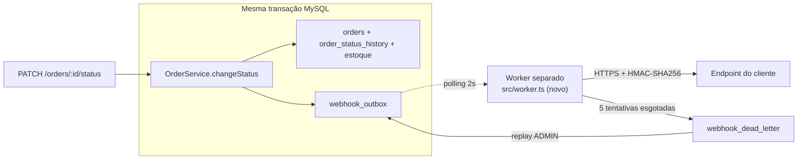

# RFC: Sistema de Webhooks de Notificação de Pedidos

| Campo | Valor |
| --- | --- |
| **Autor** | Larissa (Tech Lead) |
| **Status** | Em revisão (proposta consolidada a partir das decisões da reunião técnica) |
| **Data** | 2026-11-24 |
| **Revisores** | Marcos (Product Manager), Bruno (Eng. Pleno, Pedidos), Diego (Eng. Sênior, Plataforma), Sofia (Eng. de Segurança) |
| **Documentos relacionados** | [PRD](PRD.md) · [FDD](FDD.md) · [ADRs](adrs/README.md) · [Tracker](TRACKER.md) |

---

## 1. Resumo executivo (TL;DR)

Propomos notificar clientes B2B, por **webhooks de saída**, sempre que o status de um pedido muda. O evento é gravado em uma tabela **outbox no MySQL existente, na mesma transação** da mudança de status. Um **worker em processo separado**, em polling de 2 segundos, entrega o evento por HTTP com **assinatura HMAC-SHA256** (secret por endpoint). Falhas passam por **5 tentativas com backoff exponencial** e, esgotadas, vão para uma **DLQ** reprocessável por um ADMIN. A entrega é **at-least-once**, e o cliente deduplica por `X-Event-Id`. Não introduzimos infraestrutura nova: reaproveitamos módulos, erros, logger e middlewares do OMS.

Pedimos aos revisores: (a) validar a proposta, e (b) posicionar-se sobre as [questões em aberto](#5-questões-em-aberto), em especial as da seção 5.2, que a reunião não cobriu.

## 2. Contexto e problema

Atlas Comercial, MaxDistribuição e Nova Cargo pediram notificação em tempo real das mudanças de status dos seus pedidos; hoje consultam `GET /orders` periodicamente, o que torna a integração lenta e cara para eles (`[09:00] Marcos`). "Tempo real" significa **menos de 10 segundos** (`[09:02] Marcos`), e o fluxo é apenas **de saída**: eles recebem, não enviam (`[09:02] Marcos`). A Atlas sugeriu que poderia migrar para o concorrente se a entrega não ocorresse até o fim do trimestre (`[09:00] Marcos`).

O OMS não tem hoje nenhum mecanismo de notificação externa, evento, fila ou webhook. O ponto de origem do evento é `OrderService.changeStatus` (`src/modules/orders/order.service.ts`), que já executa uma transação "pesada": atualiza `orders`, insere em `order_status_history` e movimenta estoque (`[09:04] Bruno`). Daí vêm as duas restrições centrais do problema:

1. Um cliente lento ou fora do ar **não pode** travar nem reverter mudanças de status (`[09:04] Bruno`).
2. Se o status mudou, o evento **tem que** existir, e se a mudança foi revertida, o evento não pode sair (`[09:40] Bruno`, `[09:41] Diego`).

## 3. Proposta técnica

### 3.1 Visão geral

### 3.2 Componentes e princípios

| Componente | Proposta | ADR |
| --- | --- | --- |
| **Publicação do evento** | Função chamada dentro da transação de `changeStatus`; grava um snapshot do payload e só insere se algum webhook do customer escuta aquele status | [ADR-007](adrs/ADR-007-publicacao-transacional-com-snapshot-e-filtro.md) |
| **Armazenamento** | Outbox no MySQL existente, atômica com a mudança de status | [ADR-001](adrs/ADR-001-outbox-no-mysql.md) |
| **Entrega** | Worker em processo próprio, polling de 2s, worker único (ordering por `order_id`) | [ADR-002](adrs/ADR-002-worker-separado-com-polling-de-2s.md) |
| **Resiliência** | 5 tentativas com backoff, timeout de 10s, DLQ em tabela separada e replay administrativo | [ADR-003](adrs/ADR-003-retry-com-backoff-e-dlq.md) |
| **Segurança** | HMAC-SHA256 sobre o corpo, secret única por endpoint, rotação com 24h de convivência | [ADR-004](adrs/ADR-004-hmac-sha256-com-secret-por-endpoint.md) |
| **Semântica de entrega** | At-least-once; idempotência é do cliente, via `X-Event-Id` | [ADR-005](adrs/ADR-005-at-least-once-com-x-event-id.md) |
| **Integração com o código** | Módulo novo `src/modules/webhooks` (a criar) nos moldes dos demais; reuso de `AppError`, Pino, error middleware e `requireRole`; erros com prefixo `WEBHOOK_` | [ADR-006](adrs/ADR-006-reuso-dos-padroes-existentes-do-projeto.md) |

### 3.3 Superfície para o cliente (resumo)

O cliente, autenticado por JWT do nosso sistema, cadastra e gerencia seus webhooks (URL, lista de status de interesse), pode pedir rotação da secret e consulta o histórico de entregas. Um endpoint administrativo, restrito a `ADMIN`, reprocessa eventos da DLQ e registra quem o executou (`[09:31] Marcos`, `[09:33] Bruno`, `[09:34] Marcos`, `[09:36] Sofia`). O CRUD de configuração aceita qualquer role autenticada "por enquanto" (`[09:37] Sofia`). O `customer_id` vem no body ou no path, e não do JWT (`[09:32] Larissa`). Rotas, payloads, headers e códigos de erro estão no [FDD](FDD.md).

### 3.4 Garantias e limites assumidos

- **Latência:** abaixo de 10s; no pior caso, 2s de polling somados ao tempo de entrega (`[09:10] Larissa`).
- **Entrega:** at-least-once, com possibilidade de duplicata.
- **Ordem:** apenas por `order_id` e enquanto houver um único worker; não há garantia de ordering global (`[09:13] Larissa`). Os clientes não pediram ordering global (`[09:14] Marcos`).
- **Falha permanente:** após cerca de 15 horas de tentativas, o evento vai para a DLQ e depende de replay manual (`[09:17] Marcos`).

## 4. Alternativas consideradas

| # | Alternativa | Por que foi descartada (trade-off) | ADR |
| --- | --- | --- | --- |
| A1 | **Disparo síncrono** dentro de `changeStatus` | Ganha simplicidade, mas um cliente lento trava mudanças de outros pedidos e um cliente fora do ar forçaria rollback do status (`[09:04] Bruno`; `[09:06] Diego`) | [ADR-001](adrs/ADR-001-outbox-no-mysql.md) |
| A2 | **Fila externa** (Redis Streams ou similar) | Mais reativa e desacoplada, mas exige infraestrutura nova para um time pequeno; "Redis Cluster pra isso é overengineering" (`[09:07] Larissa`, `[09:07] Diego`) | [ADR-001](adrs/ADR-001-outbox-no-mysql.md) |
| A3 | **Trigger do MySQL** para acionar o worker | Seria mais reativa, mas o MySQL não tem listener nativo (NOTIFY/LISTEN) e a trigger só executa SQL, exigindo improviso. Polling de 2s já atende o requisito (`[09:09] Diego`) | [ADR-002](adrs/ADR-002-worker-separado-com-polling-de-2s.md) |
| A4 | **Worker dentro da API** | Menos um processo para operar, mas um restart da API perderia o worker (`[09:11] Diego`) | [ADR-002](adrs/ADR-002-worker-separado-com-polling-de-2s.md) |
| A5 | **Retry indefinido** com backoff | Nunca desiste, mas deixa evento pendurado para sempre se o cliente sumiu (`[09:15] Diego`) | [ADR-003](adrs/ADR-003-retry-com-backoff-e-dlq.md) |
| A6 | **3 tentativas** | Falha mais cedo, mas cobriria só ~30 min e já houve cliente com indisponibilidade de 2h (`[09:16] Diego`) | [ADR-003](adrs/ADR-003-retry-com-backoff-e-dlq.md) |
| A7 | **Secret global** da plataforma | Operação mais simples, mas um vazamento comprometeria todos os clientes (`[09:21] Sofia`) | [ADR-004](adrs/ADR-004-hmac-sha256-com-secret-por-endpoint.md) |
| A8 | **Exactly-once** | Tiraria a duplicata do cliente, mas exige coordenação dos dois lados e é "muito mais complexo" (`[09:25] Diego`) | [ADR-005](adrs/ADR-005-at-least-once-com-x-event-id.md) |
| A9 | **Guardar só `order_id`** na outbox e renderizar no envio | Payload sempre atual, mas o evento deixaria de refletir o estado do momento da mudança (`[09:52] Larissa`) | [ADR-007](adrs/ADR-007-publicacao-transacional-com-snapshot-e-filtro.md) |

## 5. Questões em aberto

### 5.1 Levantadas na reunião e não decididas ou adiadas

| # | Questão | Situação na reunião |
| --- | --- | --- |
| Q1 | **Rate limiting de envio por cliente.** Com 50 pedidos mudando em um minuto, bombardeamos o cliente com 50 chamadas? | Fora do escopo: "observar e decidir depois" (`[09:38] Diego`, `[09:39] Larissa`) |
| Q2 | **Aviso por e-mail** ao cliente quando o webhook falha repetidamente | Adiado para uma próxima fase, após medir o impacto (`[09:37] Larissa`) |
| Q3 | **Escala para múltiplos workers**, com particionamento por `order_id` ou lock pessimista | Adiada; hoje vale a limitação de worker único (`[09:13] Diego`) |
| Q4 | **Arquivamento das linhas entregues** da outbox (~30 dias) | Fora do escopo desta feature (`[09:08] Diego`) |
| Q5 | **Endurecer as permissões** do CRUD de configuração, hoje aberto a qualquer role autenticada | Mantido "por enquanto"; pode ser revisto (`[09:37] Sofia`) |
| Q6 | **Painel visual** para o cliente acompanhar seus webhooks | Descartado nesta fase; é projeto separado do frontend (`[09:40] Larissa`) |

### 5.2 Lacunas identificadas na consolidação (a reunião não tratou)

Estas não têm origem na transcrição; surgiram ao cruzar as decisões com o código e pedem posicionamento dos revisores.

| # | Questão | Revisor sugerido |
| --- | --- | --- |
| Q7 | **Retry × ordering.** Se um evento fica em backoff (de 1 min a 12 h), eventos posteriores do mesmo pedido seguem na frente? A "ordering por `order_id`" ([ADR-002](adrs/ADR-002-worker-separado-com-polling-de-2s.md)) vale nesse caso? | Diego |
| Q8 | **Criação de pedido gera evento?** `OrderService.create` grava `PENDING` com `fromStatus: null`; a reunião só falou em "mudança de status" ([ADR-007](adrs/ADR-007-publicacao-transacional-com-snapshot-e-filtro.md)). | Marcos, Bruno |
| Q9 | **Contagem das "5 tentativas".** Os 5 intervalos somam 14h36m, compatível com o "quase 15 horas" de Diego se o envio inicial **não** contar entre as 5 (1 envio + 5 retries = até 6 chamadas). A reunião não diz isso explicitamente; o [FDD](FDD.md) adota essa leitura ([ADR-003](adrs/ADR-003-retry-com-backoff-e-dlq.md)). | Diego |
| Q10 | **`X-Timestamp` entra na assinatura?** O header serve para detectar replay (`[09:44] Diego`), mas só protege se estiver coberto pelo HMAC ([ADR-004](adrs/ADR-004-hmac-sha256-com-secret-por-endpoint.md)). | Sofia |
| Q11 | **Armazenamento da secret** (o servidor precisa reassinar, logo não basta guardar um hash) e redact em logs: o logger atual não cobre `secret` ([ADR-004](adrs/ADR-004-hmac-sha256-com-secret-por-endpoint.md)). | Sofia |
| Q12 | **Bloqueio em cabeça de fila.** O envio é sequencial (worker único) e cada chamada pode levar até 10 s; um cliente lento atrasa os eventos dos demais e pode romper o requisito de < 10 s. Avaliar concorrência limitada, preservando a ordem por `order_id`. | Diego |
| Q13 | **Assinatura durante a rotação.** Para a secret antiga valer "em paralelo" por 24 h, o envio precisa levar assinaturas das duas secrets; o formato do `X-Signature` com duas assinaturas é proposta do [FDD](FDD.md). | Sofia |
| Q14 | **Exportação de métricas e tracing.** A reunião não definiu; o FDD propõe métricas por SQL e logs, sem dependência nova. Adotar Prometheus ou OpenTelemetry é decisão de infraestrutura. | Diego |

## 6. Impacto e riscos

### 6.1 Impacto

- **Código existente:** a única alteração em lógica de negócio é em `OrderService.changeStatus` (`src/modules/orders/order.service.ts`). Fiação em `src/app.ts` e `src/routes/index.ts`, novos scripts em `package.json` e ajuste de redact em `src/shared/logger/index.ts`. Detalhes no FDD.
- **Banco:** novas tabelas (outbox, DLQ, configuração de webhook, histórico de entregas) por migration Prisma, com UUID como PK (`[09:51] Larissa`).
- **Operação:** passa a existir um segundo processo (`npm run worker`) a implantar, monitorar e reiniciar, além da API.
- **Clientes:** precisam implementar verificação de assinatura e deduplicação por `X-Event-Id`; Marcos documentará no portal de desenvolvedores (`[09:26] Marcos`, `[09:40] Marcos`).

### 6.2 Riscos

| Risco | Prob. | Impacto | Mitigação proposta |
| --- | --- | --- | --- |
| Falha na outbox bloqueia mudança de status (consequência da atomicidade) | Baixa | Alto | Aceito por decisão (`[09:40] Bruno`); cobrir com testes ponta a ponta de `changeStatus` (`[09:46] Larissa`) |
| Crescimento da outbox sem arquivamento | Média | Médio | Índices em status e `created_at` (`[09:08] Diego`); tratar Q4 em feature posterior |
| Cliente não deduplica e processa evento duas vezes | Média | Médio | Documentação destacada no portal (`[09:26] Marcos`) |
| Vazamento de secret de cliente (já ocorreu antes: `[09:22] Diego`) | Média | Alto | Secret por endpoint, rotação com 24h de convivência e revisão de segurança (`[09:46] Sofia`) |
| Prazo: estimativa de 3 sprints incluindo a revisão da Sofia, frente ao "fim de novembro" pedido pela Atlas (`[09:45] Marcos`, `[09:46] Larissa`) | Média | Alto | Confirmar a duração do sprint e o calendário (não registrados na reunião); reservar 2 dias úteis para a revisão de segurança (`[09:46] Sofia`) |
| Perda de ordering se o worker for escalado | Baixa | Médio | Limitação documentada (`[09:13] Larissa`); resolver Q3 antes de escalar |

## 7. Decisões relacionadas

| ADR | Título |
| --- | --- |
| [ADR-001](adrs/ADR-001-outbox-no-mysql.md) | Padrão Outbox transacional no MySQL existente |
| [ADR-002](adrs/ADR-002-worker-separado-com-polling-de-2s.md) | Worker em processo separado com polling de 2 segundos |
| [ADR-003](adrs/ADR-003-retry-com-backoff-e-dlq.md) | Retry com backoff exponencial e DLQ em tabela separada |
| [ADR-004](adrs/ADR-004-hmac-sha256-com-secret-por-endpoint.md) | HMAC-SHA256 com secret por endpoint e rotação de 24h |
| [ADR-005](adrs/ADR-005-at-least-once-com-x-event-id.md) | At-least-once com deduplicação via `X-Event-Id` |
| [ADR-006](adrs/ADR-006-reuso-dos-padroes-existentes-do-projeto.md) | Reuso máximo dos padrões existentes do projeto |
| [ADR-007](adrs/ADR-007-publicacao-transacional-com-snapshot-e-filtro.md) | Publicação transacional com snapshot e filtro na inserção |

## 8. Próximos passos

Sessão de revisão com Bruno e Diego antes de iniciar a codificação (`[09:50] Larissa`) e agendamento da revisão de segurança com Sofia antes do deploy (`[09:49] Sofia`).
